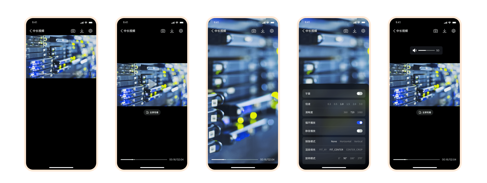
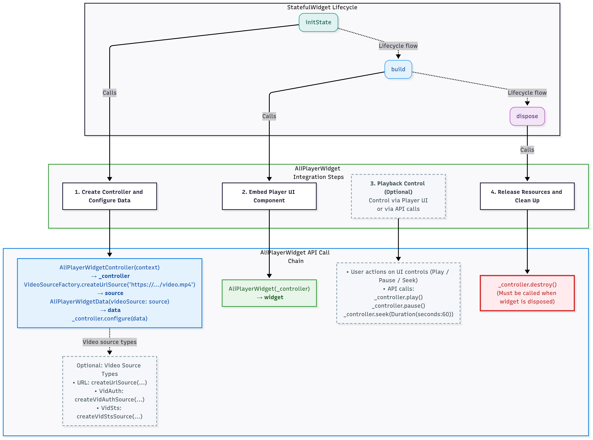

Language: [Simplified Chinese](README.md) | English

# **aliplayer_widget**

    

## **1. Overview**

**AliPlayerWidget** is a high-performance video playback component specifically designed for Flutter applications, built on top of the AliCloud Player SDK `flutter_aliplayer`. It supports multi-scenario adaptation such as Video-on-Demand (VOD), live streaming, playlist playback, and short drama scenes. Additionally, it offers a rich set of features and highly flexible UI customization capabilities, meeting video playback needs across various fields like education, entertainment, e-commerce, and short drama applications.

  

  Ready-to-use player UI components for multiple playback scenarios

With a minimalist API design, AliPlayerWidget achieves low-code integration, allowing developers to quickly implement complex video playback functionalities with just a few lines of code, significantly reducing development costs. Whether it's basic playback control or complex interactive scenarios (such as gesture adjustments and custom UI insertion), AliPlayerWidget can handle them effortlessly, helping developers build smooth and efficient user experiences.

---

## **2. Features**

### **2.1 Core Functionalities**

- **Multi-scenario Adaptation**: Supports VOD, live streaming, playlist playback, and full-screen modes.
- **Rich Feature Set**:
  - **Basic Functions**: Provides core functionalities such as playback control, settings panel, cover image display, and quality switching to meet standard video playback requirements.
  - **Gesture Control**: Supports intuitive brightness, volume, and playback progress adjustments via gestures, enhancing user experience.
  - **Support for Multiple Playback Sources**: Compatible with various video source types, including direct URL playback, VID+STS token playback, and VID+Auth authentication playback, meeting the playback requirements of different scenarios.

- **Flexible UI Customization**:
  - **Slot System**: Provides a powerful slot-based architecture that enables customization of all parts of the player UI, including the top bar, bottom bar, playback controls, cover image, subtitles, and more. Supports full slot customization, fine-grained control over the visibility and gesture interactions of UI elements within default slots, and inserting custom UI components (such as ads, bullet comments, watermarks, etc.) at any layer of the player.
  - **Modular Design**: Includes reusable UI components such as top bars, bottom bars, and settings panels, making it easy for developers to customize according to their needs.
  - **Full-Screen Adaptation**: Automatically adapts to landscape and portrait orientations, ensuring optimal display across different devices.

- **Extensible Playback Management:**
  - **Strategy System**: Includes built-in first-frame timing and stutter detection strategies, with support for custom strategy extensions, providing an independent unit for encapsulating individual business logic.
  - **Real-Time Status Monitoring**: Offers real-time updates on playback status, video dimensions, buffering progress, etc., facilitating dynamic interactions.
  - **Event Callback Mechanism**: Provides comprehensive player event listeners, including play start, pause, completion, and other state management tools, making it convenient for developers to handle various playback scenarios.
  - **Logging and Debugging Support**: Equipped with a detailed logging system to aid in troubleshooting and performance optimization.

### **2.2 Core Advantages**

- **Ease of Use**: Complex video playback functions can be implemented through simple API calls, allowing quick integration into Flutter projects.
- **Flexibility and Extensibility**:
  - Modular design supporting various customization options, enabling developers to tailor the player based on specific needs.
  - Automatic adaptation to different screen sizes and resolutions ensures consistent user experience.
- **High Performance and Stability**:
  - Built on the AliCloud Player SDK, providing low-latency and highly stable video playback.
  - Optimized architecture design featuring lightweight components, asynchronous loading, and an event-driven model to ensure efficient operation and smooth user experience.
- **Cross-Platform Support:**
  - Fully leverages Flutter's cross-platform capabilities, supporting both Android and iOS platforms, allowing single-codebase development for dual-platform execution.
  - Unified cross-platform architecture where all platforms share the same design philosophy and interface semantics, reducing multi-platform integration and maintenance costs.

| Platform | Description | Source | Documentation |
|----------|-------------|--------|---------------|
| **Android** | Native Android player UI components and scenario-based solutions | [PlayerKit-Android](https://github.com/aliyun/PlayerKit-Android) | [Online Docs](https://aliyun.github.io/PlayerKit-Android/) |
| **iOS** | Native iOS player UI components and scenario-based solutions | [PlayerKit-iOS](https://github.com/aliyun/PlayerKit-iOS) | [Online Docs](https://aliyun.github.io/PlayerKit-iOS/) |
| **Flutter** | Cross-platform Flutter player widget | [player_widget](https://github.com/aliyun/player_widget) | [Online Docs](https://aliyun.github.io/player_widget/) |

---

## **3. Quick Start**

### **3.1 Online Documentation**

**[🌐 Click here to read online](https://aliyun.github.io/player_widget/)**

### **3.2 Local Documentation**

If you prefer to read locally, please refer to [**Documentation Directory**](./docs/README-EN.md).

This directory provides a clear document structure and step-by-step instructions for **AI and developers to understand and execute together**.

---

## **4. Integration Guide**

For detailed information about prerequisites, please refer to [Integration Guide](./docs/integration-guide-en.md).

---

## **5. Quick Access**

In just a few steps, you can easily implement video playback functionality! **AliPlayerWidget** offers a minimalist API design to help you rapidly integrate video playback features with minimal coding.

For more usage and code examples, please refer to the [Quick Start Guide](./docs/quick-start-en.md).

---

## **6. Custom Features**

### **1. Slot System**

Slot is the basic building block of the player UI. The component ships with a well-designed default UI that works out of the box with zero configuration. It also provides flexible customization options: fully replace any slot, hide specific UI elements within default slots with fine-grained control, or insert custom UI components (such as ads, bullet comments, watermarks, etc.) at any layer of the player. For detailed information, please refer to [Slot System Documentation](./docs/advanced/slot-system-en.md)

### **2. Strategy System**

Strategy is the basic organizational unit for player behavior logic. Built-in recommended strategies such as first-frame timing and stutter detection work out of the box. Custom strategy development is also supported, allowing you to easily implement playback quality monitoring, event tracking, and more without modifying the player's core code. For detailed information, please refer to [Strategy System Documentation](./docs/advanced/strategy-system-en.md)

### **3. Video Source Support**

AliPlayerWidget provides flexible video source configuration methods, supporting multiple video source types. For detailed information, please refer to [Video Source Support Documentation](./docs/advanced/video-source-support-en.md)

### **4. UI Theme**

AliPlayerWidget provides a unified UI design specification, supporting quick skin replacement. Simply pass the icon resource path to achieve brand customization. For detailed information, please refer to [UI Theme Documentation](./docs/advanced/ui-theme-en.md)

### **5. API Reference**

`AliPlayerWidget` provides a series of external interfaces that allow developers to directly control player behavior. For detailed information, please refer to [API Reference Documentation](./docs/api-reference-en.md)

---

## **7. Example Project and Demo Package**

To help developers quickly get started and deeply understand how to integrate and use **AliPlayerWidget** in real-world projects, we provide two resources: the **example project** and a **demo package** built based on this project.

### **1. Example Project**

`aliplayer_widget_example` is a complete example project designed to help developers quickly understand and integrate the core functionalities of **AliPlayerWidget**.

You can access the full documentation of the example project through the following links:

- **Chinese Documentation**: [aliplayer_widget_example README](./example/README.md)
- **English Documentation**: [aliplayer_widget_example README-EN](./example/README-EN.md)

Through the example project, you can intuitively learn the following:

- How to embed a video player component.
- How to configure playback functionality for different scenarios (e.g., VOD, live streaming, playlist playback).
- How to leverage custom options to achieve personalized user experiences.

### **2. Demo Package**

To help developers quickly experience the functionalities of **AliPlayerWidget**, we have built a demo package based on the `aliplayer_widget_example` project. This demo package can be directly installed and run on a device without additional development environment setup.

#### **Access Method**

Scan the QR code below with your mobile phone to quickly download and install the demo package:

> **Note**: The QR code links to the latest version of the demo package. Ensure that your device allows the installation of third-party applications.

---

## **8. Open Source and Source Code Access**

**aliplayer_widget** has been published to the following Pub sources. Developers are recommended to integrate it via the package management tool:

- **Pub Official Source**: [pub.dev](https://pub.dev/packages/aliplayer_widget)
- **Domestic Mirror Source**: [pub.flutter-io.cn](https://pub.flutter-io.cn/packages/aliplayer_widget)

If you need to customize the component, you can use the source code dependency method to directly obtain and modify the source code. The complete source code can be accessed through the following methods:

- **GitHub Repository**: [aliplayer_widget](https://github.com/aliyun/player_widget)

If GitHub is inaccessible, you can download the source code package directly via the link below:

- **Source Code Package Download**: [aliplayer_widget.zip](https://alivc-demo-cms.alicdn.com/versionProduct/sourceCode/aliplayer_widget/aliplayer_widget.zip)

The open-source content includes:

- **Core components**: Complete implementation of `AliPlayerWidget` and `AliPlayerWidgetController`.
- **Example project**: `aliplayer_widget_example` provides code examples for scenarios such as video-on-demand, live streaming, and playlist playback, helping developers quickly integrate and get started.
- **Documentation and comments**: The source code includes detailed comments and development guidelines for easier secondary development and customization.

---

## **9. Device-Cloud Synergy**

AliPlayerWidget is built on top of Alibaba Cloud's audio and video capabilities. We recommend using it together with Alibaba Cloud products to take full advantage of device-cloud synergy and further enhance playback capabilities and the video experience.

| Cloud Product                                                | Description                                                  |
| ------------------------------------------------------------ | ------------------------------------------------------------ |
| [ApsaraVideo for VOD](https://www.alibabacloud.com/en/product/apsaravideo-for-vod) | Provides one-stop video-on-demand services, including video upload, storage, transcoding, distribution, and playback |
| [ApsaraVideo for Live](https://www.alibabacloud.com/en/product/apsaravideo-for-live) | Provides end-to-end live streaming services, including stream ingest, transcoding, distribution, and playback |

---

## **10. Contact Us**

- 📘 **Official Documentation**: [Player UI Integration Solution](https://www.alibabacloud.com/help/en/vod/developer-reference/flutter-widget-project-introduction)
- 🔍 **Console**: [VOD Console](https://vod.console.alibabacloud.com)
- 📝 **Open Ticket**: [Alibaba Cloud Official Support](https://smartservice.console.alibabacloud.com/service/create-ticket)
- 💬 **GitHub Issues**: [Feedback and Suggestions Welcome](https://github.com/aliyun/player_widget/issues)

For more FAQs and fixes about using the Alibaba Cloud player, see [FAQ about ApsaraVideo Player](https://www.alibabacloud.com/help/en/vod/support/faq-about-apsaravideo-player/).