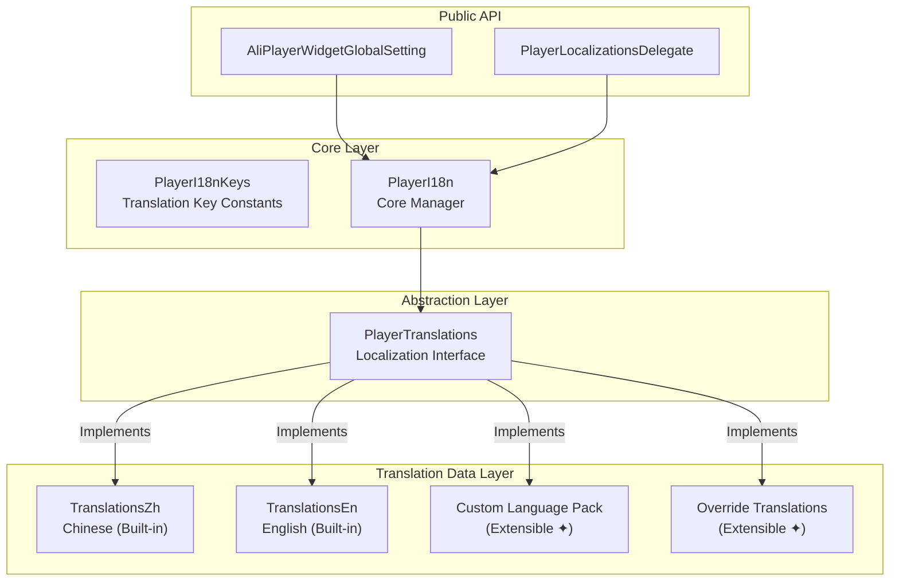

# **Internationalization (i18n)**

AliPlayerWidget provides an out-of-the-box i18n solution with built-in Chinese and English support, easily extensible to other languages.

---

## **1. Overview**

The i18n system features:

- **Built-in Chinese & English** - Ready to use without configuration
- **Auto-sync with System Locale** - Defaults to device language
- **Extensible Language Packs** - Register custom languages (Japanese, Korean, etc.)
- **Translation Override** - Customize built-in text
- **Runtime Switching** - Dynamic language changes

## **2. Architecture**



---

## **3. Usage**

### **3.1 Default Configuration**

No configuration required, the player component automatically follows the system language.

### **3.2 Switch Language**

```dart
// Switch to English
AliPlayerWidgetGlobalSetting.setLocale(const Locale('en'));

// Switch to Chinese
AliPlayerWidgetGlobalSetting.setLocale(const Locale('zh'));
```

### **3.3 Get Translation**

```dart
// Using key constant (recommended)
final text = AliPlayerWidgetGlobalSetting.t(PlayerI18nKeys.volume);

// With parameter interpolation
final speed = AliPlayerWidgetGlobalSetting.t(
  PlayerI18nKeys.speedFormat,
  {'speed': '1.5'},
);
```

### **3.4 Register New Language**

Implement `PlayerTranslations` interface and register:

```dart
// 1. Define language pack
class PlayerTranslationsKo with PlayerTranslationsMixin {
  @override
  Locale get locale => const Locale('ko');

  @override
  Map<String, dynamic> get translations => {
    'player': {
      'settings': {
        'volume': '볼륨',
        'brightness': '밝기',
        // ...
      },
    },
  };
}

// 2. Register and use
AliPlayerWidgetGlobalSetting.registerTranslations(PlayerTranslationsKo());
AliPlayerWidgetGlobalSetting.setLocale(const Locale('ko'));
```

### **3.5 Override Translations**

Modify specific translation items for a language:

```dart
AliPlayerWidgetGlobalSetting.overrideTranslations('en', {
  'player': {
    'settings': {
      'speed': 'Playback Speed',
    },
  },
});
```

### **3.6 Listen for Language Changes**

```dart
ValueListenableBuilder<Locale>(
  valueListenable: AliPlayerWidgetGlobalSetting.localeNotifier,
  builder: (context, locale, _) {
    return Text(AliPlayerWidgetGlobalSetting.t(PlayerI18nKeys.volume));
  },
)
```

### **3.7 Integration with MaterialApp**

```dart
MaterialApp(
  localizationsDelegates: const [
    PlayerLocalizationsDelegate(),
    GlobalMaterialLocalizations.delegate,
  ],
  supportedLocales: AliPlayerWidgetGlobalSetting.supportedLocales,
)
```

---

## **4. Built-in Languages**

| Language | Locale | Status |
|----------|--------|--------|
| Chinese | `zh` | Built-in |
| English | `en` | Built-in |

---

## **5. Translation Keys**

All translation keys are defined in the `PlayerI18nKeys` constant class.

Translation examples:
- Built-in: `lib/i18n/translations/`
- Custom: `example/lib/pages/i18n/translations/`

---

## **6. API Reference**

### **AliPlayerWidgetGlobalSetting**

| Method/Property | Description |
|-----------------|-------------|
| `t(key, [args])` | Get translated text |
| `setLocale(locale)` | Set current locale |
| `initI18n([locale])` | Initialize i18n |
| `registerTranslations(translations)` | Register language pack |
| `overrideTranslations(langCode, overrides)` | Override translations |
| `locale` | Current locale |
| `localeNotifier` | Locale change notifier |
| `supportedLocales` | List of supported locales |

---

## **7. Example**

See `example/lib/pages/i18n/i18n_demo_page.dart` for a complete example demonstrating:
- Runtime language switching
- Registering new language packs (Japanese)
- Overriding built-in translations
