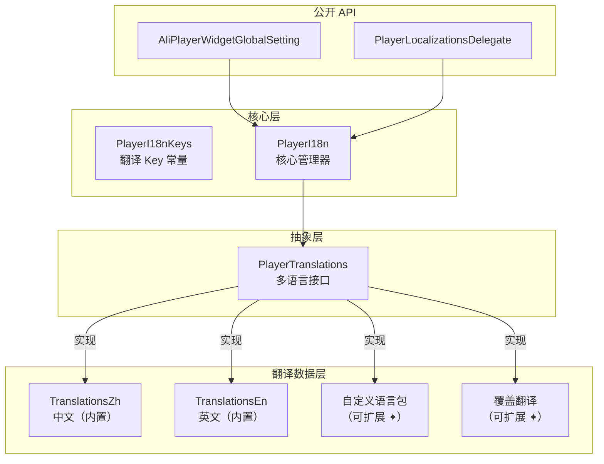

# **国际化 (i18n)**

AliPlayerWidget 提供开箱即用的国际化方案，内置中英文支持，可灵活扩展其他语言。

---

## **1. 概述**

国际化系统具有以下特性：

- **内置中英文** - 无需配置即可使用
- **自动跟随系统语言** - 默认与设备语言同步
- **扩展语言包** - 支持注册自定义语言（日语、韩语等）
- **覆盖翻译** - 可修改内置文案
- **运行时切换** - 动态切换语言

## **2. 架构设计**



---

## **3. 使用方法**

### **3.1 使用默认配置**

无需任何配置，播放器组件自动跟随系统语言。

### **3.2 切换语言**

```dart
// 切换到英文
AliPlayerWidgetGlobalSetting.setLocale(const Locale('en'));

// 切换到中文
AliPlayerWidgetGlobalSetting.setLocale(const Locale('zh'));
```

### **3.3 获取翻译**

```dart
// 使用 Key 常量（推荐）
final text = AliPlayerWidgetGlobalSetting.t(PlayerI18nKeys.volume);

// 带参数插值
final speed = AliPlayerWidgetGlobalSetting.t(
  PlayerI18nKeys.speedFormat,
  {'speed': '1.5'},
);
```

### **3.4 注册新语言**

实现 `PlayerTranslations` 接口并注册：

```dart
// 1. 定义语言包
class PlayerTranslationsKo with PlayerTranslationsMixin {
  @override
  Locale get locale => const Locale('ko');

  @override
  Map<String, dynamic> get translations => {
    'player': {
      'settings': {
        'volume': '볼륨',
        'brightness': '밝기',
        // ...
      },
    },
  };
}

// 2. 注册并使用
AliPlayerWidgetGlobalSetting.registerTranslations(PlayerTranslationsKo());
AliPlayerWidgetGlobalSetting.setLocale(const Locale('ko'));
```

### **3.5 覆盖翻译**

修改特定语言的某些翻译项：

```dart
AliPlayerWidgetGlobalSetting.overrideTranslations('zh', {
  'player': {
    'settings': {
      'volume': '音量',
      'quality': '画质',
    },
  },
});
```

### **3.6 监听语言变化**

```dart
ValueListenableBuilder<Locale>(
  valueListenable: AliPlayerWidgetGlobalSetting.localeNotifier,
  builder: (context, locale, _) {
    return Text(AliPlayerWidgetGlobalSetting.t(PlayerI18nKeys.volume));
  },
)
```

### **3.7 与 MaterialApp 集成**

```dart
MaterialApp(
  localizationsDelegates: const [
    PlayerLocalizationsDelegate(),
    GlobalMaterialLocalizations.delegate,
  ],
  supportedLocales: AliPlayerWidgetGlobalSetting.supportedLocales,
)
```

---

## **4. 内置语言**

| 语言 | Locale | 状态 |
|------|--------|------|
| 中文 | `zh` | 内置 |
| 英文 | `en` | 内置 |

---

## **5. 翻译 Key 列表**

所有翻译 Key 定义在 `PlayerI18nKeys` 常量类中。

翻译示例请参考：
- 内置翻译：`lib/i18n/translations/`
- 自定义翻译：`example/lib/pages/i18n/translations/`

---

## **6. API 参考**

### **AliPlayerWidgetGlobalSetting**

| 方法/属性 | 说明 |
|-----------|------|
| `t(key, [args])` | 获取翻译文本 |
| `setLocale(locale)` | 设置当前语言 |
| `initI18n([locale])` | 初始化国际化 |
| `registerTranslations(translations)` | 注册语言包 |
| `overrideTranslations(langCode, overrides)` | 覆盖翻译 |
| `locale` | 当前语言 |
| `localeNotifier` | 语言变化监听器 |
| `supportedLocales` | 支持的语言列表 |

---

## **7. 实践示例**

请参考 `example/lib/pages/i18n/i18n_demo_page.dart` 查看完整示例，包含：
- 运行时语言切换
- 注册新语言包（日语）
- 覆盖内置翻译
