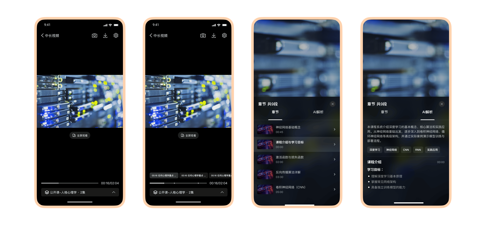
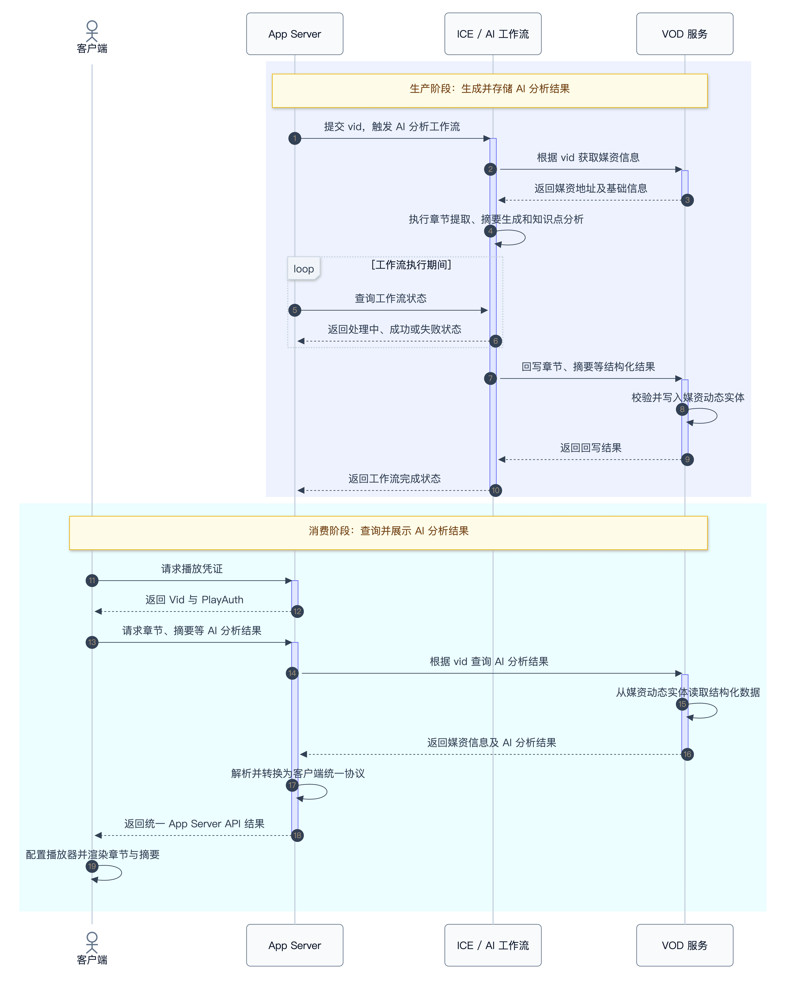
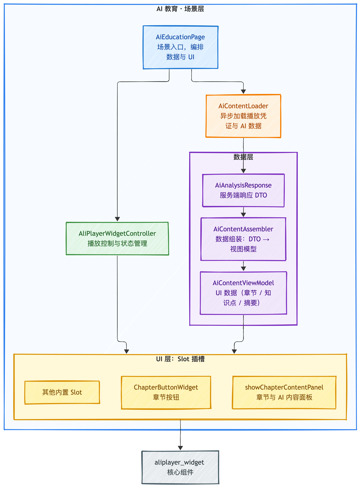

# **AI 教育场景（AI VOD）**

---

## **1. 场景介绍**

**AI 教育场景**是阿里云基于 AliPlayerWidget 与视频点播 VOD 打造的 AI 视频一体化方案，面向**在线教育、课程培训、知识传播**等场景。

它以播放器为统一入口，由 VOD 提供视频内容与服务支撑，并集成 AI 内容理解能力，自动生成章节、摘要与知识点。用户可以快速了解内容结构、定位关键片段并随时回看，让长视频从"从头看到尾"转变为"按需浏览、高效学习"。

无论是在线课程、职业培训、企业内训、付费知识服务还是学术讲座，该场景都能提升学习效率与观看体验，盘活存量视频内容，降低播放器与 AI 能力的接入开发成本。

在 Flutter 端，AI 教育场景具有以下差异化优势：

- **一套 Dart 代码双端运行**：章节标记、章节导航、右侧章节列表面板等 UI 能力均由 `aliplayer_widget` 的 Dart 层实现，无需像 Android/iOS 原生方案那样分别拷贝 `scene-ai-education` 模块或修改 Gradle/Podfile。
- **无需额外原生模块集成**：只要引入 `aliplayer_widget` 与 `flutter_aliplayer` 依赖，并复用 `example/lib/pages/ai_education/` 目录下的示例代码即可快速跑通。
- **声明式 UI 与插槽扩展**：通过 `AliPlayerWidget.slotBuilders` 注册章节按钮等自定义插槽，通过 `ChaptersPanelManager.showChaptersPanel` 独立唤起内置章节列表面板，集成方式符合 Flutter 开发习惯。
- **热重载友好**：面板样式、数据组装逻辑均在 Dart 层，开发阶段可直接通过 Flutter hot reload 调整。



---

## **2. 核心能力**

AI 教育场景围绕"**快速理解、精准导航、高效复习**"提供以下能力：

| 能力          | 说明                                                                                                           | 实现层   |
| ------------- | -------------------------------------------------------------------------------------------------------------- | -------- |
| 智能章节      | 自动识别视频内容结构并生成章节；进度条按章节绘制标记点，点击标记点可跳转                                       | 组件内置 |
| 章节导航      | 竖屏底部栏上方展示章节 Chip 列表；横屏展示当前章节信息行（章节标题、下一章按钮），点击标题唤起右侧章节列表面板 | 组件内置 |
| Seek 章节提示 | 拖动进度条时展示当前位置对应的章节信息                                                                         | 组件内置 |
| 章节缩略图    | 为章节列表中的条目展示代表性缩略图，帮助用户快速识别和定位目标内容                                             | 组件内置 |
| 内容摘要      | 提供视频整体段落摘要与思维导图标签，Markdown 格式的详细内容                                                    | 示例层   |
| 知识点提取    | 按章节自动提取关键知识点，以结构化 Markdown 展示，点击可跳转到对应时间段                                       | 示例层   |
| 横竖屏适配    | 竖屏底部栏上方展示章节条，横屏展示章节信息行，两种形态共用同一份章节数据                                       | 组件内置 |

> **提示**：组件内置的章节能力（进度条章节标记、章节导航、章节信息行、右侧章节列表面板等）只需将章节数据传入 `AliPlayerWidgetData.chapters` 即可自动生效，**不强制绑定 `SceneType.aiVod`**；AI 解析面板（摘要、知识点）由示例工程实现，可按需复制到自己的工程中，详见[自定义与扩展](#8-自定义与扩展)。

---

## **3. 前提条件**

开始集成前，请完成以下准备工作：

| 项目       | 要求                                                                                                                                                 |
| ---------- | ---------------------------------------------------------------------------------------------------------------------------------------------------- |
| 阿里云服务 | 已开通[视频点播 VOD](https://www.aliyun.com/product/vod) 和[智能媒体服务 IMS](https://www.aliyun.com/product/apsaravideo/ice)                          |
| 媒体资源   | 已准备测试视频，并完成 AI 内容分析（章节提取、摘要生成、知识点分析）                                                                                 |
| App Server | 已完成部署，可正常提供播放凭证与 AI 分析数据；可参考开源项目[VodAppServer](https://github.com/MediaBox-Demos/VodAppServer)                            |
| 组件版本 | AliPlayerWidget >= 7.18.0 |
| 版本要求 | Dart SDK >= 3.4.0 / Flutter SDK >= 3.22.0；`flutter_aliplayer >= 7.18.0`；底层 Android/iOS 原生播放器 SDK >= 7.18.0 |

> **提示**：章节 UI 能力由 `aliplayer_widget` Dart 层实现，只依赖 `AliPlayerWidgetData.chapters` 是否有有效数据，不强制要求 `sceneType` 为 `SceneType.aiVod`。

完成以上准备后，修改示例工程 `example/lib/pages/ai_education/ai_constants.dart` 中的两项配置即可运行体验：

```dart
abstract final class AiContentConstants {
  /// AI 内容分析服务的 App Server 基础地址，末尾不要带 `/`
  static const String appServerBaseUrl = 'http://your-server-host:port';

  /// 默认播放的媒体 ID（与您部署的 App Server 属于同一阿里云账号）
  static const String defaultMediaId = 'your-media-id';
}
```

---

## **4. 快速接入**

### **4.1 通用集成**

AI 教育场景基于 AliPlayerWidget 组件构建。如果尚未完成通用集成步骤，请先参考：

- [集成指引](../integration-guide.md)：组件集成（添加依赖、初始化）
- [快速开始](../quick-start.md)：组件基础用法

### **4.2 配置 App Server 与测试媒体**

打开 `example/lib/pages/ai_education/ai_constants.dart`，修改以下两项配置：

> **提示**：可以先使用官方 App Server 地址体验，但建议部署自己的服务并使用自己的地址，部署方式见 [VodAppServer](https://github.com/MediaBox-Demos/VodAppServer)。

```dart
static const String appServerBaseUrl = 'http://your-server-host:port';

static const String defaultMediaId = 'your-media-id';
```

### **4.3 验证集成**

示例工程已内置 AI 教育场景页面，入口信息如下：

| 项目 | 说明                                                      |
| ---- | --------------------------------------------------------- |
| 页面 | `example/lib/pages/ai_education/ai_education_page.dart` |
| 路由 | `/ai_education`（首页「AI 教育」入口）                   |

页面启动后会自动加载播放凭证与 AI 分析内容并起播。播放后若看到进度条上出现章节标记点、竖屏底部栏上方出现章节条，即表示集成成功；点击示例页面左上角的章节按钮可打开章节与 AI 解析面板。

---

## **5. 架构概览**

AI 教育场景由端侧、App Server、ICE / AI 工作流与视频点播 VOD 服务共同组成。

整体链路分为两个阶段：

- **生产阶段**：App Server 触发 AI 分析工作流；ICE 拉取媒体资产并完成章节提取、摘要生成、知识点分析，将结构化结果回写至 VOD。
- **消费阶段**：端侧通过 App Server 获取播放凭证与 AI 分析结果，由 AliPlayerWidget 完成视频播放、章节导航与 AI 内容展示。

### **5.1 全局业务流程**

全局业务流程描述 AI 分析结果从生产、存储到端侧消费的完整链路。

VOD 负责媒体资产与 AI 分析结果的统一存储；ICE / AI 工作流负责内容理解与结构化分析；App Server 封装服务端能力，向端侧提供统一接口。



### **5.2 端侧分层架构**

端侧采用三层设计：场景示例层（`example/lib/pages/ai_education/`）、组件能力层（`aliplayer_widget`）与播放器 SDK（`flutter_aliplayer`）。章节 UI 能力位于组件能力层，只要业务层向 `AliPlayerWidgetData.chapters` 传入有效数据即可生效，**不强制要求页面使用 `SceneType.aiVod`**。

数据与控制在 Flutter 端的分层关系如下图所示：



---

## **6. 服务端接口**

### **6.1 获取播放凭证**

| 项目     | 说明                            |
| -------- | ------------------------------- |
| 请求方式 | GET                             |
| 请求路径 | `/appServer/GetVideoPlayAuth` |
| 请求参数 | `videoId`（必填，视频 ID）    |

**请求示例**：

```
GET http://your-server-host:port/appServer/GetVideoPlayAuth?videoId=201558617a9e71f1bfb9e6e7e5780102
```

**响应示例**：

```json
{
  "code": 0,
  "success": true,
  "data": {
    "videoId": "your-video-id",
    "playAuth": "eyJ..."
  }
}
```

**响应字段说明**：

| 字段              | 类型        | 说明                      |
| ----------------- | ----------- | ------------------------- |
| `code`          | `Integer` | 业务状态码，0 表示成功    |
| `success`       | `Boolean` | 请求是否成功              |
| `data.videoId`  | `String`  | 视频 ID                   |
| `data.playAuth` | `String`  | Base64 编码的播放授权凭证 |

### **6.2 获取 AI 分析内容**

| 项目     | 说明                                                            |
| -------- | --------------------------------------------------------------- |
| 请求方式 | GET                                                             |
| 请求路径 | `/GetMediaAiAnalysisByResultType`                             |
| 必填参数 | `MediaId`（视频 ID）                                          |
| 可选参数 | `ResultType`（`Chapter` / `Summary`，不传则返回全部类型） |

**请求示例**：

```
GET http://your-server-host:port/GetMediaAiAnalysisByResultType?MediaId=201558617a9e71f1bfb9e6e7e5780102
```

**响应示例**：

```json
{
  "AiAnalysisResult": [
    {
      "ResultType": "Chapter",
      "Title": "视频章节",
      "chapterContentItems": [
        {
          "ChapterId": 1,
          "StartTime": 0,
          "EndTime": 120000,
          "ChapterTitle": "课程介绍",
          "Summary": "本章节介绍课程的整体框架...",
          "ThumbnailUrl": "https://example.com/thumb1.jpg",
          "KnowledgePoints": [
            { "PointId": 1, "Point": "核心概念", "Description": "描述内容..." }
          ]
        }
      ]
    },
    {
      "ResultType": "Summary",
      "Title": "视频摘要",
      "summaryContent": {
        "ParagraphSummary": "本视频主要讲述了...",
        "MindMapSummary": [
          { "Title": "核心概念", "Topics": [] }
        ],
        "MarkdownContent": "# 课程摘要\n\n..."
      }
    }
  ]
}
```

> **提示**：接入自有服务端时，返回相同的 JSON 结构即可，端侧不关心服务端实现方式。
>
> **字段名大小写说明**：示例 DTO 按上表所示的字段名解析（如 `chapterContentItems`、`Description`、`Topics`）。若服务端实际返回 iOS 风格的字段名（如 `ChapterContentItems`、`PointDescription`、`Topic`），需要同步调整 `example/lib/pages/ai_education/data/ai_analysis_response.dart` 中的 `fromJson` 映射，或让服务端统一返回上述示例结构。

**章节字段说明**：

| 字段                              | 类型        | 说明                 |
| --------------------------------- | ----------- | -------------------- |
| `ChapterId`                     | `Integer` | 章节 ID              |
| `StartTime`                     | `Long`    | 章节开始时间（毫秒） |
| `EndTime`                       | `Long`    | 章节结束时间（毫秒） |
| `ChapterTitle`                  | `String`  | 章节标题             |
| `Summary`                       | `String`  | 章节文字摘要         |
| `ThumbnailUrl`                  | `String`  | 章节缩略图 URL       |
| `KnowledgePoints[].PointId`     | `Integer` | 知识点 ID            |
| `KnowledgePoints[].Point`       | `String`  | 知识点名称           |
| `KnowledgePoints[].Description` | `String`  | 知识点描述           |

**摘要字段说明**：

| 字段                 | 类型       | 说明                                                          |
| -------------------- | ---------- | ------------------------------------------------------------- |
| `ParagraphSummary` | `String` | 段落摘要文本                                                  |
| `MindMapSummary`   | `Array`  | 思维导图摘要列表（递归结构，每项包含`Title` 与 `Topics`） |
| `MarkdownContent`  | `String` | Markdown 格式内容                                             |

**接口约定**：

| 项目      | 说明                                               |
| --------- | -------------------------------------------------- |
| HTTP 超时 | 5 秒（连接 + 读取）                                |
| 异常处理  | 接口失败时降级为普通播放模式（不展示 AI 解析面板） |
| 时间单位  | `StartTime` / `EndTime` 单位为毫秒             |

---

## **7. 数据模型与映射**

### **7.1 数据映射**

| 服务端 JSON 字段      | 端侧 DTO                                 | 业务模型                          | 说明                                  |
| --------------------- | ---------------------------------------- | --------------------------------- | ------------------------------------- |
| `ChapterId`         | `AiChapterContentItem.chapterId`       | `ChapterInfo.id`                | 转为 String                           |
| `StartTime`         | `AiChapterContentItem.startTime`       | `ChapterInfo.startMs`           | 毫秒                                  |
| `EndTime`           | `AiChapterContentItem.endTime`         | `ChapterInfo.endMs`             | 毫秒                                  |
| `ChapterTitle`      | `AiChapterContentItem.chapterTitle`    | `ChapterInfo.title`             |                                       |
| `ThumbnailUrl`      | `AiChapterContentItem.thumbnailUrl`    | `ChapterInfo.thumbnailUrl`      |                                       |
| `Summary`           | `AiChapterContentItem.summary`         | `KnowledgeInfo.contentMarkdown` | 经三级降级生成                        |
| `KnowledgePoints[]` | `AiChapterContentItem.knowledgePoints` | `KnowledgeInfo.contentMarkdown` | 拼接为 Markdown（优先级高于 Summary） |
| `ParagraphSummary`  | `AiSummaryContent.paragraphSummary`    | `SummaryInfo.paragraphSummary`  | 视频级摘要                            |
| `MindMapSummary`    | `AiSummaryContent.mindMapSummary`      | `SummaryInfo.mindMapTitles`     | 提取顶层 Title 列表                   |
| `MarkdownContent`   | `AiSummaryContent.markdownContent`     | `SummaryInfo.markdownContent`   | Markdown 格式内容                     |

### **7.2 展示模型**

最终组装产物为 `AiContentViewModel`，由 `AiContentAssembler.buildViewModel(AiAnalysisResponse)` 一次性生成，作为 AI 解析面板的唯一数据入口：

| 字段 / 方法        | 类型                    | 说明                                                                       |
| ------------------ | ----------------------- | -------------------------------------------------------------------------- |
| `chapters`       | `List<ChapterInfo>`   | 章节列表（空列表表示无章节数据），直接用于 `AliPlayerWidgetData.chapters`。**章节 UI 能力与 `SceneType` 无关，不强制绑定 AI VOD 场景。** |
| `knowledgeItems` | `List<KnowledgeInfo>` | 知识点列表（文字解析样式）                                                 |
| `summaryInfo`    | `SummaryInfo?`        | 视频摘要（图解解析样式，可空）                                             |
| `hasChapterData` | `bool`                | 是否有章节数据                                                             |
| `hasSummaryData` | `bool`                | 是否有摘要数据                                                             |
| `hasAnyContent`  | `bool`                | 是否有任何有效内容                                                         |

AI 解析面板的 Tab 样式不再体现在聚合模型字段上，而是由面板内部根据数据推导：

| 数据场景         | Tab 结构 | Tab 1           | Tab 2           |
| ---------------- | -------- | --------------- | --------------- |
| 仅章节（无摘要） | 双 Tab   | 章节            | AI 解析（文字） |
| 仅摘要（无章节） | 无 Tab   | AI 解析（图解） | —              |
| 章节 + 摘要      | 双 Tab   | 章节            | AI 解析（图解） |

### **7.3 端侧数据架构**

端侧采用"数据组装与 UI 渲染分离"的分层设计：服务端响应先落地为纯 DTO，再由组装器转换为展示模型，最后交给 UI 层渲染。

**数据流转**：

```
服务端 JSON → AiAnalysisResponse（DTO）→ AiContentAssembler → AiContentViewModel → 播放器配置 / AI 解析面板
```

**端侧模型说明**：

| 类                     | 职责                                                                                                                                                   |
| ---------------------- | ------------------------------------------------------------------------------------------------------------------------------------------------------ |
| `AiContentAssembler` | 纯静态无状态组装器；`buildViewModel(AiAnalysisResponse)` 将 DTO 转换为展示模型                                                                       |
| `AiContentViewModel` | 面板展示层模型；字段：`chapters` / `knowledgeItems` / `summaryInfo`                                                                              |
| `KnowledgeInfo`      | 知识点信息；字段：`title` / `startMs` / `endMs` / `contentMarkdown`（预格式化：`- **{Point}**：{Description}`）                              |
| `SummaryInfo`        | 视频摘要信息；字段：`paragraphSummary` / `mindMapTitles`（`List<String>`）/ `markdownContent`                                                  |
| `ChapterInfo`        | 组件内置章节模型（`aliplayer_widget`）；字段：`id` / `startMs` / `endMs` / `title` / `thumbnailUrl`，提供 `findIndexByPosition` 二分查找。**只要传入 `AliPlayerWidgetData.chapters` 即生效，不依赖 `SceneType.aiVod`。** |

**设计原则**：

- **单一职责**：DTO 只负责 JSON 映射，组装器只负责数据转换，UI 只负责渲染
- **三级降级**：`KnowledgeInfo.contentMarkdown` 生成规则为 KnowledgePoints 优先 → Summary 其次 → 两者皆空则为 null
- **时间有序**：章节与知识点列表按时间范围有序且不重叠，`findIndexByPosition` 以二分查找定位当前项

---

## **8. 自定义与扩展**

### **8.1 替换数据源**

示例工程通过 `AiContentLoader` 加载数据（dio 实现，5 秒连接与接收超时，支持 `cancel()` 取消）。接入自有数据源时，可参考其流程替换数据加载逻辑，只要最终能产出 `AiAnalysisResponse` DTO 即可复用整条组装链路：

```dart
final loader = AiContentLoader();
loader.loadPlayAuth(vid, (playAuth) {
  // 获取到 playAuth 后，继续加载 AI 分析内容
  loader.loadAiAnalysis(vid, (response) {
    // response 为纯 DTO，消费方需显式调用 AiContentAssembler 组装
    final content = response != null
        ? AiContentAssembler.buildViewModel(response)
        : null;
    // 配置播放器，详见 8.3
  });
});
```

> **提示**：章节数据由 `AiContentAssembler.buildViewModel` 统一组装，章节与摘要类 AI 内容无法直接挂在 `AliPlayerWidgetData` 上，需由业务层在打开面板时显式传入 `showChapterContentPanel`。

### **8.2 自定义 UI**

- **替换 AI 解析面板样式**：复制 `example/lib/pages/ai_education/chapter_content_panel_widget.dart` 后按需修改布局与样式，面板对外仅暴露 `showChapterContentPanel(...)` 一个入口。
- **扩展插槽**：通过 `AliPlayerWidget` 的 `slotBuilders` 注册自定义插槽。示例工程使用自定义插槽实现左上角章节按钮：

```dart
static const _slotTypeChapterShow = SlotType(
  'chapterShowButton',
  defaultOrder: 55,
);

AliPlayerWidget(
  _controller,
  slotBuilders: {
    _slotTypeChapterShow: (context) => ChapterButtonWidget(
      controller: _controller,
      onTap: () => _showChapterContentPanel(context),
    ),
  },
);
```

- **复用章节列表面板**：组件内置的右侧滑入章节列表面板可独立唤起：

```dart
ChaptersPanelManager.showChaptersPanel(
  context: context,
  chapters: chapters,
  currentIndex: currentIndex,
  onChapterSelected: (index) {
    _controller.seek(Duration(milliseconds: chapters[index].startMs));
  },
);
```

- 插槽机制的详细说明见[插槽系统](../advanced/slot-system.md)，场景能力说明见[场景类型](../advanced/scene-type.md)。

### **8.3 接入自有页面**

如果不使用示例页面，可参考其实现在自己的页面中完成以下步骤：

1. 创建 `AliPlayerWidgetController`
2. 请求播放凭证与 AI 分析内容
3. 组装 `AiContentViewModel`，配置 `AliPlayerWidgetData`（`chapters` 必填；`sceneType` 按需设置，示例使用 `SceneType.aiVod`）
4. 注册章节按钮等自定义插槽
5. 点击章节时调用 `showChapterContentPanel` 展示 AI 内容
6. 页面销毁时取消加载任务并销毁控制器

**示例骨架**：

```dart
class AiEducationPage extends StatefulWidget {
  const AiEducationPage({super.key});

  @override
  State<AiEducationPage> createState() => _AiEducationPageState();
}

class _AiEducationPageState extends State<AiEducationPage> {
  late final AliPlayerWidgetController _controller;
  AiContentLoader? _contentLoader;
  AiContentViewModel _content = const AiContentViewModel(
    chapters: [],
    knowledgeItems: [],
  );

  static const _slotTypeChapterShow = SlotType(
    'chapterShowButton',
    defaultOrder: 55,
  );

  @override
  void initState() {
    super.initState();
    _controller = AliPlayerWidgetController();

    const vid = AiContentConstants.defaultMediaId;
    final loader = AiContentLoader();
    _contentLoader = loader;

    // 链式加载：PlayAuth → AI 内容 → 配置播放器
    loader.loadPlayAuth(vid, (playAuth) {
      if (playAuth == null || playAuth.isEmpty) return;
      loader.loadAiAnalysis(vid, (response) {
        if (response != null) {
          _content = AiContentAssembler.buildViewModel(response);
        }
        _configure(vid, playAuth);
      });
    });
  }

  void _configure(String vid, String playAuth) {
    final source = VideoSourceFactory.createVidAuthSource(
      vid: vid,
      playAuth: playAuth,
    );
    _controller.configure(
      AliPlayerWidgetData(
        videoSource: source,
        sceneType: SceneType.aiVod,
        chapters: _content.chapters,
      ),
    );
  }

  void _showChapterContentPanel(BuildContext context) {
    if (!_content.hasAnyContent) return;
    final position = _controller.currentPositionNotifier.value;
    final currentIndex = ChapterInfo.findIndexByPosition(
      _content.chapters,
      position.inMilliseconds,
    );
    showChapterContentPanel(
      context: context,
      content: _content,
      currentIndex: currentIndex,
      onChapterSelected: (index) {
        final chapter = _content.chapters[index];
        _controller.seek(Duration(milliseconds: chapter.startMs));
      },
      onSegmentSelected: (startMs) {
        _controller.seek(Duration(milliseconds: startMs));
      },
    );
  }

  @override
  Widget build(BuildContext context) {
    return Scaffold(
      body: AliPlayerWidget(
        _controller,
        slotBuilders: {
          _slotTypeChapterShow: (context) => ChapterButtonWidget(
            controller: _controller,
            onTap: () => _showChapterContentPanel(context),
          ),
        },
      ),
    );
  }

  @override
  void dispose() {
    _contentLoader?.cancel();
    _controller.destroy();
    super.dispose();
  }
}
```

> **提示**：示例工程还处理了以下边界情况，复制到自己的工程时建议保留：
>
> - PlayAuth 获取失败时通过 `ToastUtils` 提示并调用 `Navigator.of(context).pop()`，避免停留在黑屏页面；
> - AI 内容加载失败不影响正常播放，仅提示用户知情，随后仍调用 `_configure` 完成播放器配置；
> - 使用 `_isChapterContentPanelShowing` 状态防止用户连续点击导致面板重复弹出；
> - 在 `dispose()` 中依次调用 `_contentLoader?.cancel()` 和 `_controller.destroy()`，释放网络请求与播放器资源。

---

## **9. 集成 FAQ**

| 问题                          | 解决方案                                                                                                                                                                                                                                                                             |
| ----------------------------- | ------------------------------------------------------------------------------------------------------------------------------------------------------------------------------------------------------------------------------------------------------------------------------------ |
| 播放凭证获取失败              | 检查 App Server 地址是否正确、网络是否连通、`videoId` 是否有效；示例在获取失败时会提示并退出页面                                                                                                                                                                                   |
| AI 内容为空                   | 确认视频已完成 AI 内容分析；AI 分析接口失败不影响播放，端侧降级为普通点播模式（无 AI 解析面板）                                                                                                                                                                                      |
| 如何使用自己的视频 ID         | 修改`AiContentConstants.defaultMediaId`，或在业务调用时动态传入                                                                                                                                                                                                                    |
| 进度条章节标记 / 章节条不显示 | 确认已向 `AliPlayerWidgetData.chapters` 传入不少于 2 条的有效章节数据；章节能力与 `sceneType` 无强绑定关系                                                                                                                                                                |
| 横屏没有章节信息行            | 章节信息行在传入有效 `chapters` 数据后展示，与 `SceneType.aiVod` 无强绑定；需先确认章节数据已传入                                                                                                                                                                              |
| 如何关闭某个 AI 能力          | 服务端接口中不返回对应`ResultType` 即可（如只返回 `Chapter` 不返回 `Summary`），面板 Tab 结构会随数据自动调整                                                                                                                                                                  |
| 组件版本要求 | AliPlayerWidget >= 7.18.0；`flutter_aliplayer >= 7.18.0`；底层原生播放器 SDK >= 7.18.0。章节 UI 能力为纯 Dart 实现，不依赖 `SceneType.aiVod` |
| 横竖屏切换后章节面板位置异常  | 确认页面已配置支持方向变化（例如`SystemChrome.setPreferredOrientations` 或 `MaterialApp` 方向设置）。Flutter 端面板通过 `OrientationBuilder` / `MediaQuery.orientationOf` 自适应布局，无需像 Android 原生方案那样在 `AndroidManifest.xml` 中声明 `android:configChanges` |
| Markdown 渲染异常             | 检查`pubspec.yaml` 中已正确引入 Markdown 渲染依赖（示例工程使用 `markdown: ^7.2.0`，并基于 `Document().parse()` 自绘）；确认服务端返回的 `MarkdownContent` 为合法 Markdown 字符串，且不包含未适配的 HTML 标签                                                                |
| 章节按钮不显示                | 确认`AiContentViewModel.hasAnyContent` 为 `true`（即章节或摘要数据非空）；确认已通过 `AliPlayerWidget.slotBuilders` 注册了 `_slotTypeChapterShow` 自定义插槽                                                                                                                 |
| AI 内容请求超时               | 示例`AiContentLoader` 使用 5 秒连接与接收超时。若网络环境较差，可复制 `AiContentLoader` 的实现并调整 dio 的 `connectTimeout` / `receiveTimeout`                                                                                                                              |
